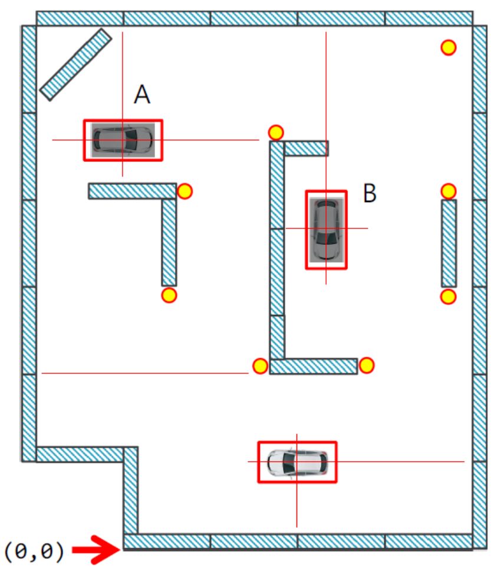
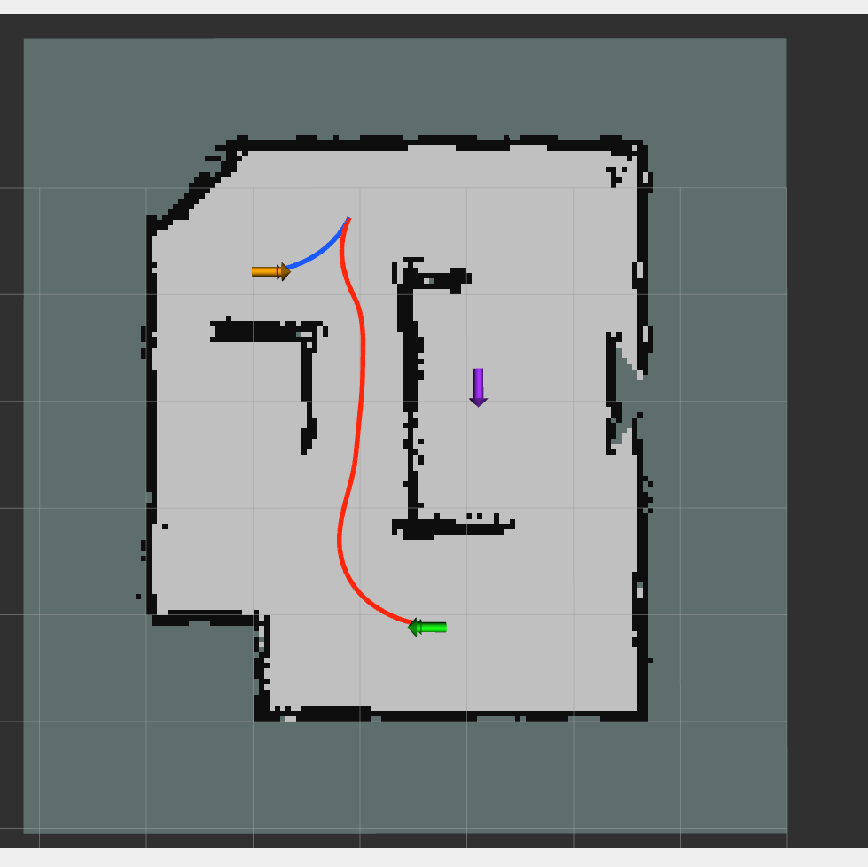
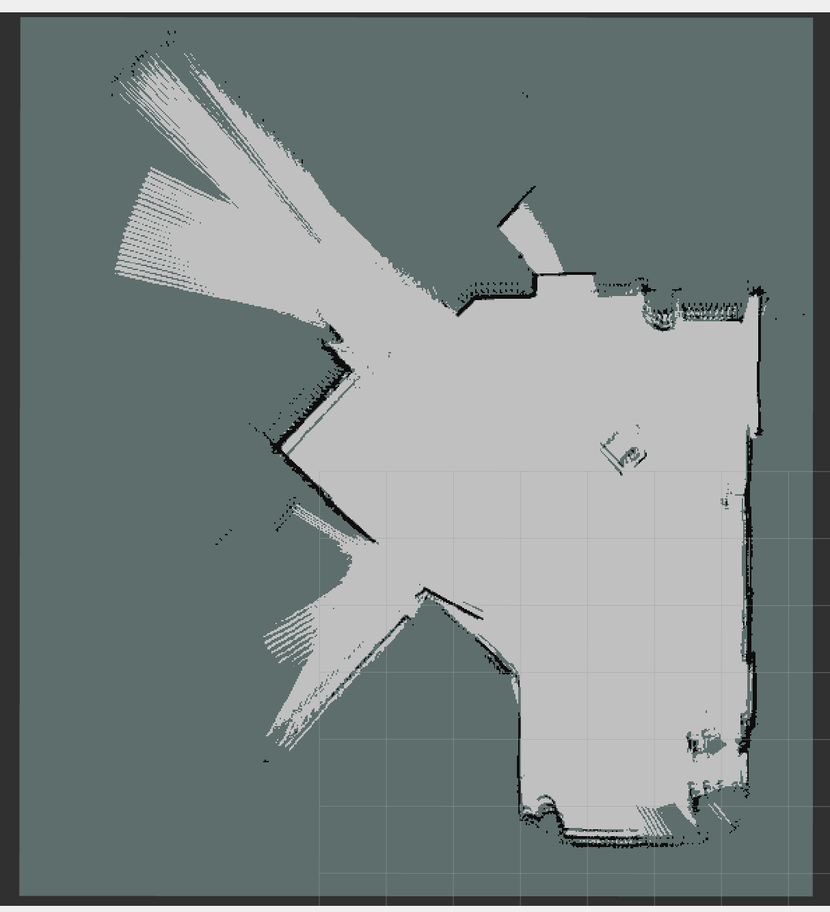

# KMU 자율주행 주차경기 Localization 및 경로 계획

국민대 자율주행 주차경기는 주최 측이 제공한 정적 지도 위에서 차량의 위치와
방향을 실시간으로 추정하고, **START → Parking A → Parking B → START**
순서로 이동하면서 지정된 목표 Pose에 맞춰 주차하는 경기입니다.

이 저장소에서는 제공 지도 기반 Localization에 AMCL을 사용하고, 추정된 현재
위치에서 경로를 계획한 뒤 차량이 경로를 따라가도록 구성했습니다. AMCL은 경기의
필수 방식이 아니라 이 저장소에서 선택한 위치 추정 방식입니다.

## 경기 목표 Pose

| 지점 | x | y | yaw |
|---|---:|---:|---:|
| START | 1.8 | 0.9 | 3.14 |
| Parking A | 0.0 | 4.2 | 0.0 |
| Parking B | 2.1 | 3.3 | -1.57 |

### 경기 진행 도면

1. 출발지점에서 출발합니다.
2. Parking A로 이동하여 주차합니다. 도면상 T자 후진주차 형태로 예상됩니다.
3. Parking A에서 빠져나와 Parking B로 이동합니다.
4. Parking B에 주차합니다. 도면상 평행주차 형태로 예상됩니다.
5. Parking B에서 빠져나와 출발지점으로 복귀합니다.

START는 대회 측에서 권장한 출발 Pose이며, 각 Parking Zone에서는
목표 위치뿐 아니라 차량 방향도 함께 맞춰야 합니다. Parking A와 B의 정확한
주차 형식이 각각 T자 후진주차와 평행주차인지는 현재 공지만으로 확정하지 않고,
설정된 목표 Pose를 만족하는 것을 기준으로 합니다.

전체 동작은 **제공 지도 불러오기 → 현재 위치와 방향 추정 → 다음 지점까지 경로
계획 → 경로 추종 → 주차 자세 맞추기** 순서로 진행됩니다.

## 지도

### parking_map

`parking_map`은 대회 측에서 제공한 실제 대회 지도입니다.

`parking_map`의 Map Origin은 `(-2.15, -1.05, 0)`입니다. 이 값은 차량의
출발 위치가 아니라 PGM 이미지를 실제 지도 좌표계에 배치하는 기준입니다.

### kmu_parking

`kmu_parking`은 KMU 연습 공간을 Cartographer로 직접 매핑한 연습용
지도입니다.

자세한 지도 정보는 [maps/README.md](maps/README.md)에 정리되어 있습니다.

## Cartographer Mapping

Cartographer Mapping은 차량을 직접 움직이는 기능이 아닙니다. 운전자가 차량을
천천히 이동시키는 동안 LiDAR와 IMU로 주변 구조와 차량의 이동을 계산하여 지도를
만듭니다. `kmu_parking`이 이 방식으로 만들어진 연습용 지도입니다. 실제
주차경기의 핵심은 새 지도를 만드는 것이 아니라 주최 측의 `parking_map` 위에서
차량 위치를 추정하고 주차 임무를 수행하는 것입니다.

매핑 중 차량은 다음과 같이 다루어집니다.

- LiDAR 전방 영역을 중심으로 차량 이동량을 계산합니다.
- IMU가 정상일 때는 회전량 계산을 보조합니다.
- 순간적으로 잘못 들어온 센서 값은 바로 위치에 반영하지 않고 마지막으로
  신뢰할 수 있었던 위치를 유지합니다.
- 센서 간격이 갑자기 길어지거나 시간이 역행하면 그 구간의 이동량을 누적하지
  않습니다. 센서 재연결 직후 차량 위치가 크게 튀는 현상을 줄이기 위한
  처리입니다.
- LiDAR 매칭 품질이 연속으로 나쁘면 운동 예측을 제거한 방식으로 한 번 더
  계산합니다. 재계산도 실패하면 틀린 위치를 채택하지 않고 이전 위치를
  유지합니다.
- IMU가 잠시 끊겨도 LiDAR 상태가 정상이면 LiDAR만으로 위치 계산을
  계속합니다.

매핑 품질을 위해서는 급가속과 급회전을 피하고, 벽이나 기둥처럼 LiDAR가 구분할
수 있는 구조물이 충분히 보이도록 주행하는 것이 좋습니다.

## AMCL Localization과 차량 주행

AMCL Localization은 이미 만들어진 지도 위에서 실제 차량의 현재 위치와 방향을
찾습니다. 자율주행은 이 위치가 충분히 안정됐을 때만 시작됩니다.

### 출발 전 동작

차량은 AMCL 위치가 아직 없거나 위치 오차가 큰 상태에서 출발하지 않습니다.
대회 임무를 시작하려면 다음 조건을 만족해야 합니다.

- 차량의 현재 위치와 방향이 정상적으로 추정되어야 합니다.
- 차량이 설정된 START 지점에서 0.50 m 이내에 있어야 합니다.
- 차량 방향이 START 방향에서 30° 이내여야 합니다.

조건을 만족하지 않으면 경로를 만들거나 임무 단계를 넘기지 않고 정지 상태로
기다립니다.

### 대회 임무의 이동 순서

차량은 다음 순서로 이동합니다.

1. START에서 Parking A로 이동합니다.
2. Parking A에 도착하면 완전히 정지하고 1초 동안 대기합니다.
3. 현재 위치를 기준으로 Parking B까지의 경로를 다시 만든 뒤 이동합니다.
4. Parking B에 도착하면 다시 완전히 정지하고 1초 동안 대기합니다.
5. 현재 위치를 기준으로 START까지의 복귀 경로를 만든 뒤 이동합니다.
6. START에 돌아오면 정지 상태를 유지하며 임무를 종료합니다.

각 구간은 이전에 예상한 위치가 아니라 최신 AMCL 위치에서 새로 계획합니다.
따라서 앞 구간에서 작은 위치 오차가 생겨도 다음 구간이 그 오차를 그대로
이어받지 않도록 했습니다.

일반적인 도착 판정은 목표에서 0.15 m 이내이고 방향 오차가 10° 이내일 때
성립합니다. 다만 추종기가 이미 최종 정지했고 목표까지의 거리가 0.30 m
이내라면, 방향 조건을 만족하지 못했더라도 해당 지점에 도착한 것으로 처리할 수
있습니다. 목표에서 더 멀리 정지한 경우에는 다음 단계로 넘어가지 않습니다.

### 전진 주행

차량은 기본적으로 전진 경로를 따라 움직입니다. 주행 중에는 여러 조향 방향을
짧게 예측하고, 차량 외곽선이 장애물과 겹치지 않으면서 경로에 가장 자연스럽게
이어지는 방향을 선택합니다.

- 직선에 가까운 구간에서는 기본 속도로 이동합니다.
- 조향각이 커지면 회전 중 흔들림과 경로 이탈을 줄이기 위해 속도를 낮춥니다.
- 목표 지점이나 전진·후진 전환 지점에 가까워지면 미리 감속합니다.
- 장애물과의 여유 거리가 줄어들면 속도를 추가로 낮춥니다.
- 모든 조향 후보가 장애물과 충돌한다고 판단되면 그대로 전진하지 않고
  정지합니다.

### 후진 주차

경로는 가능한 구간까지 전진으로 만들고, 주차 자세를 맞추기 위해 필요한 마지막
구간에서만 후진을 사용합니다. 후진은 목표 주변에서 시작하며, 계획되는 마지막
후진 구간은 최대 1.5 m로 제한되어 있습니다.

전진에서 후진으로 바뀔 때 차량은 전환 지점에서 즉시 기어를 바꾸지 않습니다.
전환 지점의 진행 방향을 맞춘 뒤 완전히 정지하고 1초 동안 기다린 다음
후진합니다. 후진에서 전진으로 바뀌는 경우에도 같은 방식으로 완전 정지 후
기어를 전환합니다.

후진 중에는 차량 뒤쪽이 LiDAR에 잘 보이지 않으므로 후방 초음파 센서를 우선
사용합니다. 후방 중앙과 좌우 중 하나라도 장애물을 연속으로 감지하면 즉시
정지합니다. 초음파 데이터가 없거나 오래됐거나 필요한 센서 값이 비어 있어도
안전한 후진으로 판단하지 않고 정지합니다.

## 예외처리와 복구 동작

### 위치 추정이 불안정한 경우

다음 상황에서는 차량이 새로운 주행을 시작하지 않거나, 주행 중이라면 속도
명령을 0으로 만들어 정지합니다.

- AMCL 초기 위치가 아직 설정되지 않은 경우
- 위치 표준편차가 0.50 m를 초과한 경우
- 방향 표준편차가 15°를 초과한 경우
- 차량 위치 변환이 0.50초 이상 갱신되지 않은 경우
- LiDAR 데이터가 없거나 0.50초 이상 갱신되지 않은 경우
- 현재 위치를 계산하는 과정에서 좌표 변환에 실패한 경우

AMCL의 무작위 전역 복구는 비활성화되어 있습니다. 위치가 크게 어긋난 경우에는
차량이 잘못된 위치에서 다시 움직이지 않도록 정지한 뒤, 운용자가 실제 차량의
위치와 방향을 다시 지정해야 합니다.

정지 중에는 AMCL 위치 메시지가 매 순간 새로 나오지 않을 수 있습니다. 이때는
메시지 개수만 보고 고장으로 판단하지 않고, 실제 차량 위치가 최신 상태인지도
함께 검사합니다.

### 전방이 막힌 경우

전진 가능한 조향 방향이 하나도 없을 때는 다음 조건을 모두 만족하는 경우에만
한 번의 짧은 후진 복구를 시도합니다.

- 차량이 자동주행 상태이며 그 상태 정보가 최신이어야 합니다.
- 후방 초음파가 정상이고 뒤쪽 공간이 안전해야 합니다.
- 같은 막힘 상황에서 아직 후진 복구를 시도하지 않았어야 합니다.

조건을 만족하면 먼저 0.5초 동안 정지한 뒤 최대 0.20 m만 직선으로 천천히
후진합니다. 후진 중 뒤쪽 장애물이 감지되면 즉시 정지합니다. 후진이 끝난 뒤
0.8초 동안 다시 정지하여 차량을 안정시키고 전진 경로 추종을 재개합니다.

초음파가 없거나 뒤가 막혀 있거나 자동주행 상태를 확인할 수 없으면 후진하지
않습니다. 같은 장애물 앞에서 짧은 후진을 반복하며 위험해지지 않도록 이 복구는
한 번만 허용됩니다.

### 전진으로 목표에 도달하지 못한 경우

전진 경로의 끝까지 갔지만 목표 위치와 방향을 만족하지 못하면 다음 순서로 한
번만 자세를 다시 맞춥니다.

1. 완전히 정지하고 1초 동안 기다립니다.
2. 목표 방향을 기준으로 최대 0.25 m 후진합니다.
3. 다시 완전히 정지하고 1초 동안 기다립니다.
4. 목표를 향해 전진을 한 번 더 시도합니다.

마지막 전진에서도 도착 조건을 만족하지 못하면 더 이상 반복하지 않고 정지
상태를 유지합니다.

### 후진으로 목표에 도달하지 못한 경우

후진 경로를 정상적으로 따라갈 수 없거나 후진 끝에서 목표 자세를 만족하지
못하면 다음과 같이 한 번만 재시도합니다.

1. 완전히 정지하고 1초 동안 기다립니다.
2. 목표 방향을 따라 최대 0.90 m 전진하여 다시 정렬할 공간을 만듭니다.
3. 다시 완전히 정지하고 1초 동안 기다립니다.
4. 원래의 후진 주차를 한 번 더 시도합니다.

후방 초음파가 장애물을 감지한 경우에도 무조건 재시도하지 않습니다. 전진으로
안전하게 빠져나올 수 있는 조건이 갖춰진 경우에만 위 복구를 수행하며, 두 번째
후진도 실패하면 정지합니다.

### 경로와 주행 상태가 맞지 않는 경우

- 경로가 아직 준비되지 않았으면 차량은 움직이지 않습니다.
- 경로의 전진·후진 정보가 빠졌거나 경로 길이와 맞지 않으면 잘못된 경로로
  움직이지 않고 정지합니다.
- 주행 도중 차량을 수동으로 경로 시작점 부근에 되돌려 놓으면, 시작 방향과
  위치가 맞는 경우 이전 진행 기록을 초기화하고 같은 경로를 처음부터 다시
  따라갑니다.
- 임무가 끝났거나 주행 기능이 종료될 때는 마지막으로 정지 명령을 보내고
  정지 상태를 유지합니다.

## 주요 안전 기준

| 상황 | 차량 동작 기준 |
|---|---|
| 임무 시작 | START에서 거리 0.50 m, 방향 30° 이내 |
| 일반 도착 | 목표에서 거리 0.15 m, 방향 10° 이내 |
| 최종 정지 보완 판정 | 목표에서 거리 0.30 m 이내 |
| 위치 불확실 | 위치 표준편차 0.50 m 또는 방향 표준편차 15° 초과 시 정지 |
| 센서·위치 갱신 지연 | 0.50초 초과 시 정지 |
| 기어 전환 | 완전 정지 후 1초 대기 |
| 전방 막힘 복구 | 최대 0.20 m 후진, 한 번만 수행 |
| 전진 도착 실패 복구 | 최대 0.25 m 후진 후 전진 한 번 재시도 |
| 후진 도착 실패 복구 | 최대 0.90 m 전진 후 후진 한 번 재시도 |
